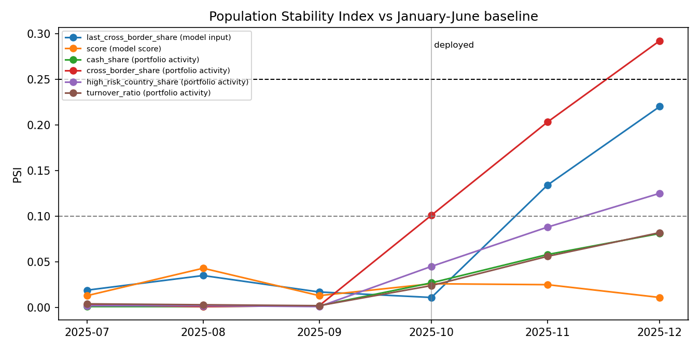
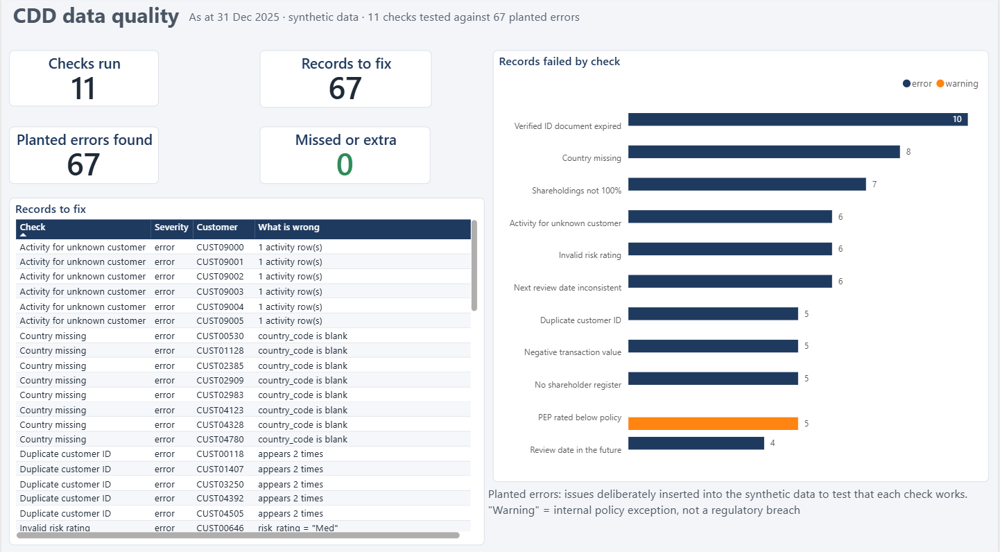
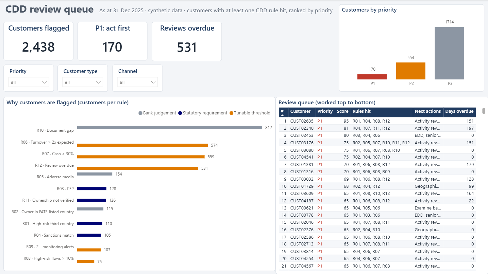
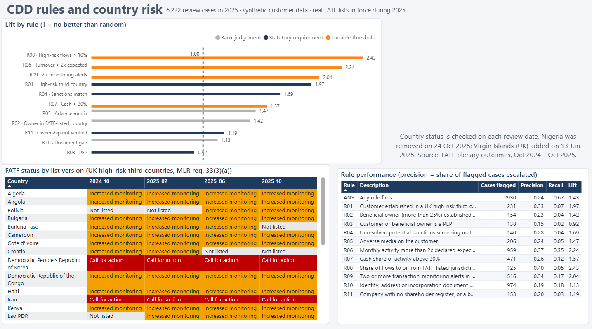
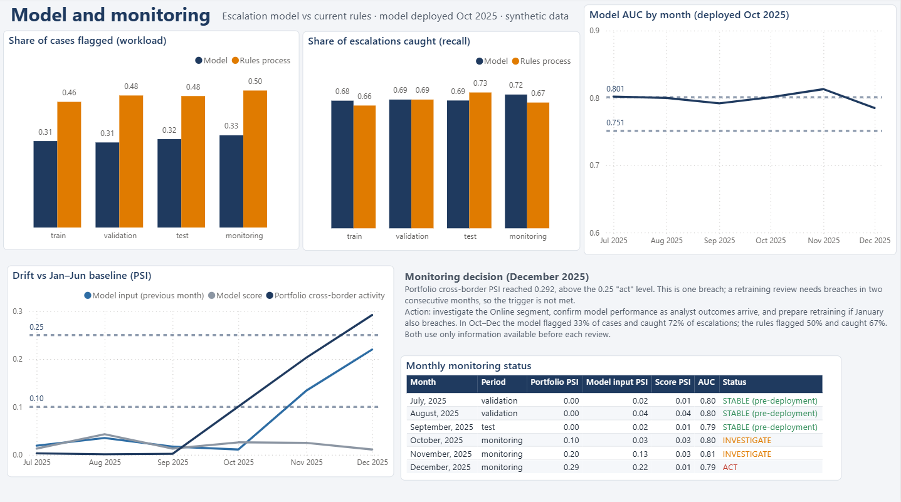

# CDD Risk Decisioning & Model Monitoring


A Customer Due Diligence (CDD) pipeline for a UK bank, built in PostgreSQL and Python, with a Power BI dashboard. It checks KYC data quality, applies 12 CDD rules based on the UK Money Laundering Regulations 2017, ranks a review queue with reason codes, tests an escalation model against the current rules process, and monitors the model after deployment.

> **Data:** customers, activity and analyst outcomes are **synthetic**, generated by a script. The country risk reference data is **real**: the FATF lists in force during 2025, with their effective dates. Results show the method, not real-world accuracy.

---

## The problem

A CDD team has to keep customer records complete and correct, decide which customers need enhanced due diligence (EDD) or a review, explain each decision against regulation, and spend analyst time where it matters. Three questions follow:

1. Which records are wrong or incomplete?
2. Which customers need action now, and why?
3. Can a model rank review cases better than the rules alone, and how would we know if it stopped working?

## How it works

```
generate_data.py      8 CSV files: synthetic customers, owners, documents, activity (Oct 2024-Dec 2025), review cases (2025)
                      + real FATF list history (Oct 2024 - Oct 2025) + 12 CDD rules with legal basis
        ↓
load_postgres.py      PostgreSQL database cdd:  RAW (as delivered, all text)
        ↓
sql/01_staging.sql    STAGING: typed, trimmed, nothing silently corrected; row counts reconciled
sql/02_dq_checks.sql  11 data-quality checks → exceptions, summary, test against the answer key
sql/03_risk_rules.sql 12 rules for every customer (31 Dec 2025) and every review case (on its date)
sql/04_review_queue   priority score, P1 / P2 / P3, reason codes, next actions, overdue reviews
sql/05_rule_effect.   precision, recall and lift of each rule against analyst escalations
sql/06_model_features one row per review case, using only information available on the review date
        ↓
train_model.py        logistic regression vs random forest, fixed protocol → validation report
monitor.py            monthly drift (PSI) and performance, with a pre-set retraining rule
export_powerbi.py     12 CSV files → Power BI dashboard (4 pages)
```

### Point-in-time country risk
Since SI 2024/69, a UK "high-risk third country" (MLR 2017 reg. 33(3)(a)) is any jurisdiction on the FATF lists *as they have effect from time to time*. Country status is therefore checked on each review date, not taken from today's list. For example, Nigeria was removed on 24 October 2025: reviews before that date trigger rule R01, reviews from that date do not. The Virgin Islands (UK) were added on 13 June 2025.

### The 12 rules

| Code | Rule | Legal basis (MLR 2017 unless stated) | Type |
|---|---|---|---|
| R01 | Customer in a UK high-risk third country on the review date | reg. 33(1)(b), 33(3)(a) | Statutory |
| R02 | Beneficial owner (>25%) in a FATF-listed jurisdiction | reg. 28(3A), 33(1)(a), 33(6)(c) | Bank judgement |
| R03 | Customer or beneficial owner is a PEP | reg. 33(1)(d), 35(5); domestic PEPs reg. 35(3A) | Statutory |
| R04 | Unresolved potential sanctions match | Sanctions and Anti-Money Laundering Act 2018 | Statutory |
| R05 | Adverse media | reg. 33(1)(a), (g) | Bank judgement |
| R06 | Activity above 2× expected turnover | reg. 33(1)(f), 33(4), 28(11)(a) | Illustrative threshold |
| R07 | Cash share above 30% | reg. 33(6)(a)(v) | Illustrative threshold |
| R08 | Flows to or from FATF-listed jurisdictions above 10% | reg. 33(6)(c), 28(11)(a) | Illustrative threshold |
| R09 | 2 or more monitoring alerts in a month | reg. 28(11)(a) | Illustrative threshold |
| R10 | Document missing, pending or expired | reg. 28(2), 28(3), 28(11)(b) | Bank judgement (applies the duty to keep CDD up to date) |
| R11 | No shareholder register, or a beneficial owner not verified | reg. 5(1)(b), 28(3A), 28(4) | Statutory |
| R12 | Periodic review overdue (High 1, Medium 2, Low 3 years) | reg. 28(11)(b) | Illustrative cycle |

Full wording, next actions and sources: `data/raw/cdd_rules.csv` (created by the generator).

---

## Results

### 1. Data quality
11 checks found all **67 planted issues: 67 matched, 0 missed, 0 extra**. Invalid values such as a risk rating of "LOW " are flagged, not auto-corrected, because a rating is a decision that must be fixed at source. A PEP rated below internal policy is reported as a policy exception (warning), not as a regulatory breach.

### 2. Review queue (as at 31 December 2025)
**2,438 of 5,000 customers** have at least one rule hit: **170 P1** (every unresolved sanctions match is P1), **554 P2**, **1,714 P3**. **531 periodic reviews are overdue.**

### 3. Rule effectiveness (6,222 review cases, 2025)
Each case is evaluated on its review date, using only activity from months completed before the review.
- The rules flag **47% of cases** and catch **67% of escalations**, with **24% precision**.
- Activity rules discriminate best: R06, R08 and R09 have lift above 2.
- R03 (PEP) has lift below 1. It is **not** a candidate for removal: EDD for PEPs is a statutory requirement. Only the illustrative thresholds (R06-R09, R12) are open to tuning.

### 4. Escalation model
Protocol fixed before training: **train** Jan-Jun 2025, **validation** Jul-Aug (choose model and threshold), **test** Sep (used once), **monitoring** Oct-Dec.

**Same information cutoff for everything:** the model's features, the rules baseline and the simulated analyst outcome all use only activity from months completed before the review month (the review month's totals include days after the review date). Country status is taken on the review date. The bank's risk rating is a 31 Dec 2025 value, so the model does not use it; it appears only as a retrospective baseline.

- Logistic regression kept as champion: the random forest was not better on validation (PR-AUC −0.010; the pre-set rule needed +0.02 to accept the less explainable model).
- Threshold set on validation to match the rules' recall with the least workload.
- **September test:** AUC **0.792** (95% CI 0.742-0.840). The model flagged **173 of 540 cases** against **257** for the rules (33% fewer), with precision **0.36 vs 0.26** and recall **0.685 vs 0.728**: fewer reviews for slightly lower capture. The rules' points score gives AUC 0.71; the bank's 31 Dec risk rating gives 0.57.

Details: [`reports/model_validation.md`](reports/model_validation.md).

### 5. Monitoring
- **July-September: stable** (all PSI below 0.05).
- From October, Online customers' cross-border activity drifts: portfolio PSI **0.10 → 0.20 → 0.29** (investigate in October and November, act in December). The model's input follows one month later (0.03 → 0.13 → 0.22); the model score stays stable (PSI ≤ 0.03) and monthly AUC stays between 0.785 and 0.813, above the trigger level of 0.751.
- **Decision:** one breach (December) does not meet the pre-set two-consecutive-month retraining rule. Action: investigate the Online segment, confirm performance as outcomes arrive, prepare retraining if January also breaches.
- **October-December:** the model flagged 33% of cases and caught 72% of escalations; the rules flagged 50% and caught 67%.

Details: [`reports/monitoring.md`](reports/monitoring.md).



### 6. Dashboard
`dashboard/cdd_dashboard.pbix`, four pages: data quality, review queue, rules and FATF country status, model and monitoring.






---

## Testing

- **57 pytest tests**, all passing (`tests/`). They include an independent pandas recomputation of rules R06-R09 and R12, point-in-time FATF checks (Nigeria, Virgin Islands (UK)), information-cutoff checks (no activity from after the review date in rules, triggers or features; the 31 Dec rating not used by the model), a regression test for defect D1, and checks on every Power BI export file.
- **CI:** GitHub Actions rebuilds the whole pipeline from an empty PostgreSQL database, produces the Power BI export and runs the tests on every push (`.github/workflows/ci.yml`).
- **Test plan** with 18 test cases and the defect log: [`docs/test_plan.md`](docs/test_plan.md).

### Defects found

| # | Found by | Problem | Fix |
|---|---|---|---|
| D1 | Monitoring: PSI 0.35 on a model input in July, before any drift existed | PostgreSQL `GREATEST()` ignores NULL, so cases with no earlier activity were given "very low turnover" instead of "unknown" | Keep missing history NULL; retrained (test AUC 0.756 → 0.762); regression test |
| D2 | Dashboard check against FATF lists | Power BI read list versions such as "2024-10" as dates and grouped them by year, showing wrong statuses | Set the column to Text |
| D3 | Building the data model | A text-only CSV loaded without column names | Use first row as headers |
| D4 | Model view review | Power BI auto-created relationships on unrelated columns | Replaced with 5 relationships on keys |
| D5 | Independent review | The rules baseline and the simulated outcome used the whole review month's activity (including days after the review date), while the model used only earlier months, so the comparison was not like for like. The model also used the 31 Dec risk rating | One information cutoff for rules, triggers, features and outcome; rating removed from the model; data regenerated and all results re-run; regression tests added |
| D6 | Independent review | R10 (expired documents) was labelled statutory | Relabelled as bank judgement applying the duty to keep CDD up to date |

---

## How to run

Requirements: Python 3.10+, PostgreSQL (tested on 17), Power BI Desktop for the dashboard.

```powershell
pip install -r requirements.txt

python src\generate_data.py                 # 8 CSV files in data\raw
python src\load_postgres.py --port 5432     # creates database cdd; asks for the password
python src\run_sql.py --port 5432           # runs sql\01 ... sql\06 in order
python src\train_model.py --port 5432       # model, scores, reports\model_validation.md
python src\monitor.py --port 5432           # monitoring tables, reports\monitoring.md, charts
python src\export_powerbi.py --port 5432    # CSV files for the dashboard
```

Use your own PostgreSQL port (5432 is the default). Passwords are typed when asked and never stored. To run the tests, set `PGPORT` and `PGPASSWORD` in your session, then `python -m pytest -v`.

## Project structure

```
CDD-Risk-Decisioning-Model-Monitoring/
├── src/          generate_data.py, load_postgres.py, run_sql.py,
│                 train_model.py, monitor.py, export_powerbi.py
├── sql/          01_staging … 06_model_features
├── tests/        57 pytest tests
├── reports/      model_validation.md, monitoring.md, charts, result tables
├── dashboard/    cdd_dashboard.pbix
├── data/powerbi/ dashboard data (data/raw is regenerated, not stored)
├── docs/         test_plan.md, stakeholder_memo.md, screenshots
└── .github/workflows/ci.yml
```

## Limitations and scope

- Customers, activity and analyst outcomes are synthetic; the escalation outcome was simulated separately from the rules, including a factor no rule or model sees.
- Country risk uses the FATF lists that define UK high-risk third countries; other geographical risk factors (for example corruption indices) are not included.
- The rules follow published UK regulation; numeric thresholds and review cycles are illustrative bank-policy values, not a bank's actual rulebook.
- Documents and shareholder registers exist only as a 31 December 2025 snapshot, so R10, R11 and the related model inputs are retrospective for earlier reviews. There is no sanctions-match resolution field, so every screening hit is treated as unresolved.
- The Power BI file is tested by hand; CI checks the data it reads.
- Not covered: real CDD decision-making, work with banking stakeholders, team-based Agile delivery, and other BI tools such as QuickSight.

---

**Aditya Ranjan** · [LinkedIn](https://www.linkedin.com/in/aditya-ranjan-data) · [GitHub](https://github.com/beingbrute) · [Portfolio](https://beingbrute.github.io)
