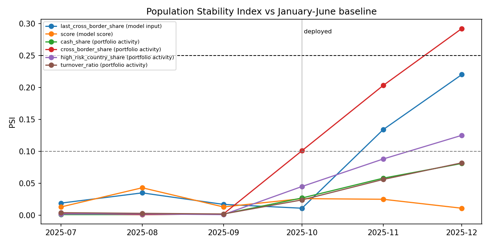
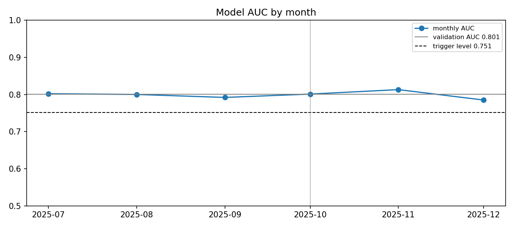

# Model monitoring report

Generated by `src/monitor.py`. Baseline: training window January-June 2025.
July-September are pre-deployment reference months; October-December are the simulated
post-deployment period. Figures come from synthetic data.

**Rules (set before looking at the monitoring months):** PSI below 0.1 stable,
0.1-0.25 investigate, above 0.25 act. Performance concern: AUC more than 0.05
below the validation AUC (0.801). A month is a breach (ACT) if any PSI is above 0.25
or AUC drops by more than 0.05. Retraining review: a breach in two consecutive
post-deployment months.

## 1. Monthly status
| month | period | auc | auc_vs_validation | max_portfolio_psi | max_model_input_psi | score_psi | status |
|---|---|---|---|---|---|---|---|
| 2025-07-01 | validation | 0.802 | 0.001 | 0.004 | 0.024 | 0.013 | STABLE (pre-deployment) |
| 2025-08-01 | validation | 0.8 | -0.001 | 0.003 | 0.035 | 0.043 | STABLE (pre-deployment) |
| 2025-09-01 | test | 0.792 | -0.009 | 0.002 | 0.021 | 0.013 | STABLE (pre-deployment) |
| 2025-10-01 | monitoring | 0.801 | -0.0 | 0.101 | 0.034 | 0.026 | INVESTIGATE |
| 2025-11-01 | monitoring | 0.813 | 0.012 | 0.203 | 0.134 | 0.025 | INVESTIGATE |
| 2025-12-01 | monitoring | 0.785 | -0.016 | 0.292 | 0.22 | 0.011 | ACT |

**Decision:** Breach in 2025-12-01, but not in two consecutive months, so the retraining trigger was not met. Action: investigate the drifting segment, confirm performance as outcomes arrive, and prepare retraining if the next month also breaches.

## 2. PSI by variable and month
| source | variable | 2025-07-01 | 2025-08-01 | 2025-09-01 | 2025-10-01 | 2025-11-01 | 2025-12-01 |
|---|---|---|---|---|---|---|---|
| model input | alerts_4m | 0.017 | 0.003 | 0.01 | 0.028 | 0.007 | 0.004 |
| model input | last_cash_share | 0.024 | 0.028 | 0.021 | 0.034 | 0.041 | 0.063 |
| model input | last_cross_border_share | 0.019 | 0.035 | 0.017 | 0.011 | 0.134 | 0.22 |
| model input | last_hrtc_flow_share | 0.013 | 0.013 | 0.02 | 0.014 | 0.082 | 0.071 |
| model input | log_last_turnover_ratio | 0.012 | 0.023 | 0.01 | 0.022 | 0.043 | 0.049 |
| model score | score | 0.013 | 0.043 | 0.013 | 0.026 | 0.025 | 0.011 |
| portfolio activity | cash_share | 0.001 | 0.001 | 0.002 | 0.027 | 0.058 | 0.081 |
| portfolio activity | cross_border_share | 0.003 | 0.001 | 0.002 | 0.101 | 0.203 | 0.292 |
| portfolio activity | high_risk_country_share | 0.002 | 0.002 | 0.001 | 0.045 | 0.088 | 0.125 |
| portfolio activity | turnover_ratio | 0.004 | 0.003 | 0.002 | 0.024 | 0.056 | 0.082 |

## 3. Performance by month (threshold 0.1840 from validation)
| month | period | cases | escalated | auc | auc_vs_validation | workload | precision | recall |
|---|---|---|---|---|---|---|---|---|
| 2025-07-01 | validation | 531 | 74 | 0.802 | 0.001 | 0.301 | 0.325 | 0.703 |
| 2025-08-01 | validation | 487 | 81 | 0.8 | -0.001 | 0.316 | 0.357 | 0.679 |
| 2025-09-01 | test | 540 | 92 | 0.792 | -0.009 | 0.32 | 0.364 | 0.685 |
| 2025-10-01 | monitoring | 481 | 89 | 0.801 | -0.0 | 0.291 | 0.414 | 0.652 |
| 2025-11-01 | monitoring | 556 | 91 | 0.813 | 0.012 | 0.369 | 0.361 | 0.813 |
| 2025-12-01 | monitoring | 553 | 99 | 0.785 | -0.016 | 0.336 | 0.366 | 0.687 |

Monthly samples are small (about 500-600 cases and 80-100 escalations), so month-to-month
AUC moves by a few points without any real change.

## 4. How to read this
- Portfolio activity PSI shows a change in customer behaviour as soon as it happens.
- Model inputs use the previous completed month, so the same change reaches the model's
  inputs one month later.
- A drift alert means "the population has changed; check whether the model still works".
  It is not proof that the model is wrong. The performance section answers that question,
  but only once analyst outcomes are known, which in practice lags the scores.
